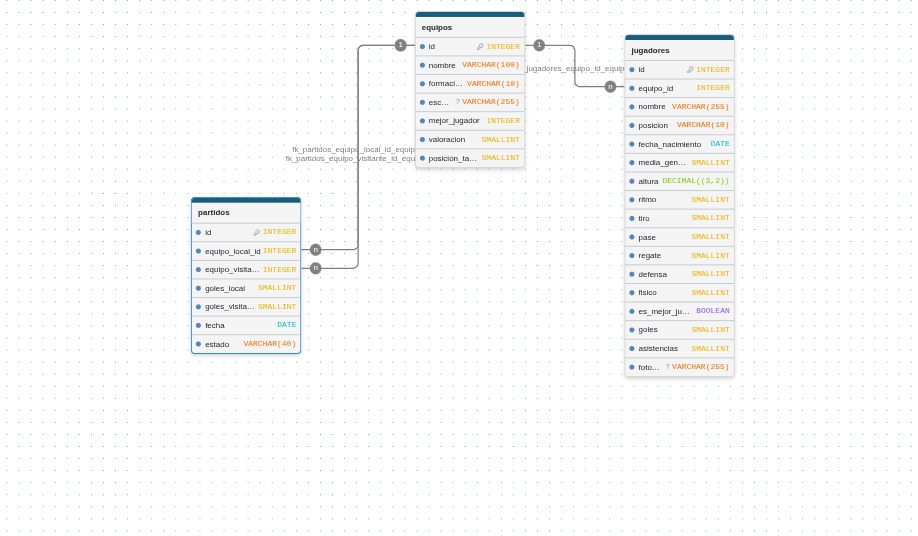

## REQUISITOS PREVIOS:
- Docker y Docker Compose instalados y en ejecución.
- Puertos `8080` (HTTP) y `5432` (PostgreSQL) libres en el equipo.

## PARA EJECUTAR EL SERVIDOR, UTILIZAR:
1. Clonar el repositorio y entrar a la carpeta:
```bash
   git clone -b tp3 https://github.com/ezequielalecci/Tp-ProgWeb
   cd Tp-ProgWeb
```

2. Levantar la aplicación con **una** de estas dos opciones:

   **Opción A: con Make (recomendada)**
```bash
   make sqlc    # genera el código con sqlc
   make up      # compila y levanta los contenedores
```

   **Opción B: con Docker Compose**
```bash
   sqlc generate
   docker compose up --build -d
```

3. Abrir en el navegador:
   - Página principal: <http://localhost:8080>
   - Resultados (tablas y formularios para cargar equipos, jugadores y partidos): <http://localhost:8080/resultados-api.html>

4. Al terminar, borrar contenedores y volúmenes:
```bash
   make clean
   # o bien: docker compose down -v
```

> **Datos de prueba:** al iniciar se cargan equipos, jugadores y partidos de ejemplo desde `db/test-data.sql`. Si preferís arrancar con la base vacía, comentá en `docker-compose.yml` la línea:
> ```yaml
> - ./db/test-data.sql:/docker-entrypoint-initdb.d/2_test-data.sql
> ```
> Los scripts de inicialización solo se ejecutan cuando el volumen está vacío. Si cambiás algo en `db/`, ejecutá antes `make clean`.

Con `make help` se ve la lista de comandos disponibles.

## Ejecutar las pruebas

Las pruebas verifican todos los endpoints de la API con `curl`. Con un solo comando se hace todo el proceso:

```bash
make test
```

Esto ejecuta, en orden:

1. **Tareas previas:** `sqlc generate`, borrado de contenedores y volúmenes, compilación y arranque con Docker, y espera hasta que la base de datos y la API estén listas.
2. **Pruebas:** `scripts/test-api.sh` recorre cada endpoint:
   - **Equipos:** listar, obtener, crear, actualizar y eliminar.
   - **Jugadores:** listar, obtener, listar por equipo, crear, actualizar estadísticas y eliminar.
   - **Mejor jugador:** consultar el mejor jugador de un equipo.
   - **Partidos:** listar, obtener, crear, actualizar resultado, eliminar, y consultar el último partido, el último finalizado y el último con detalle.
   - **Validaciones y errores:** datos inválidos (400) y recursos inexistentes (404).
   - **Datos extra de prueba:** el equipo AC Milan, el jugador Luka Modric y el partido Barcelona vs Milan en curso.
3. **Tareas posteriores:** se borran contenedores y volúmenes, **aunque las pruebas fallen**.

Cada prueba muestra `PASS` o `FAIL` y al final un resumen (`Resultado: N correctas, M fallidas`). El comando termina con código distinto de 0 si alguna falla.


## DETALLES DE ESTA TERCERA PARTE:
+ se eliminaron los archivos generados por sqlc (por lo que se debe correr los comandos indicados en la parte superior para no tener errores)
+ se ajusto la lógica de negocios en una capa de handlers (donde cada archivo maneja que rutas tiene disponible) y otra de service (con validaciones) 
+ se agregaron test para probar los endpoints de forma automática y rápida
+ se agrego .gitignore y .dockerignore

esta seria la estructura de la base de datos


PARA FUTURAS EDICIONES:
+ Si se nos solicita agregaremos .env 

DETALLES DE NUESTRA PÁGINA:
Nuestra página consta de un tablero que enseña equipos cargados por el administrador, donde los usuarios que la utilicen pueden ver información acerca de los mismos. Por ejemplo, plantel, valoración media del equipo, mejores jugadores, estadísticas individuales de cada jugador, últimos resultados de ese equipo, posición en la tabla, etc.
Para ello, cada elemento tendrá:
+ Tarjeta del equipo
    Es la información resumida que se muestra en el tablero:

    -Nombre
    -Valoración media
    -Cantidad de jugadores
    -Posición en la tabla

+ Detalle del equipo
    Se muestra al hacer clic en la tarjeta del equipo:

    -Nombre
    -Formación
    -Plantel de jugadores
    -Mejor jugador
    -Valoración media
    -Últimos resultados
    -Estadísticas generales del equipo

+ Tarjeta de jugador
    Información resumida de cada jugador dentro del plantel:

    -Nombre
    -Media del jugador
    -Posición

+ Detalle del jugador
    Informacion detallada que se muestra al hacer click sobre la carta del jugador:

    -Nombre
    -Posición
    -Edad
    -Media
    -Partidos jugados
    -Goles
    -Asistencias
    -Otras estadísticas individuales (velocidad, regate, tiro, etc)