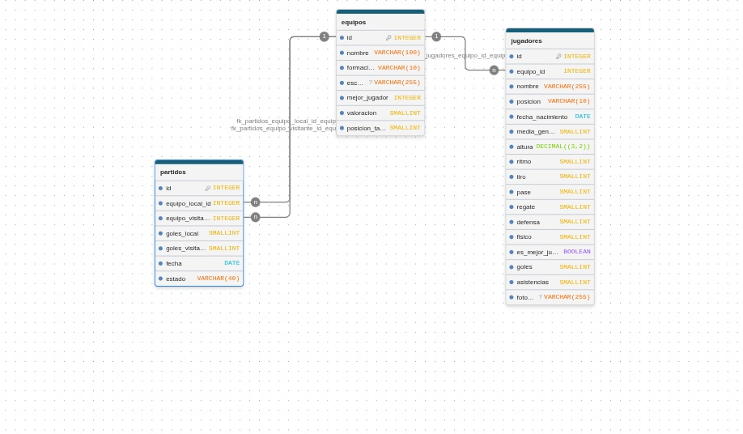

## REQUISITOS PREVIOS:
- Docker y Docker Compose instalados y en ejecución.
- Puertos `8080` (HTTP) y `5432` (PostgreSQL) libres en el equipo.

## PARA EJECUTAR EL SERVIDOR, UTILIZAR:
1. Clonar el repositorio y entrar a la carpeta:
```bash
   git clone -b tp5 https://github.com/ezequielalecci/Tp-ProgWeb
   cd Tp-ProgWeb
```

2. Levantar la aplicación con **una** de estas dos opciones:

   **Opción A: con Make (recomendada)**
```bash
   make run     # crea el .env automáticamente, genera el código, levanta la base y espera a que respondan
```

   **Opción B: con Docker Compose**
```bash
   cp .env.example .env
   sqlc generate
   templ generate
   docker compose up --build -d
```
   (el código de templ se genera dentro del build de Docker)

3. Abrir en el navegador <http://localhost:8080>. La página tiene tres pestañas, cada una con su formulario de alta y su tabla:
   - Equipos: <http://localhost:8080/>
   - Jugadores: <http://localhost:8080/?tab=jugadores>
   - Partidos: <http://localhost:8080/?tab=partidos>

4. Al terminar, borrar contenedores y volúmenes:
```bash
   make clean
   # o bien: docker compose down -v
```

> **Datos de prueba:** al iniciar se cargan equipos, jugadores y partidos de ejemplo desde `db/test-data.sql`. Si preferís arrancar con la base vacía, comentá en `docker-compose.yml` la línea:
> ```yaml
> - ./db/test-data.sql:/docker-entrypoint-initdb.d/2_test-data.sql
> ```
> Los scripts de inicialización solo se ejecutan cuando el volumen está vacío. Si cambiás algo en `db/`, ejecutá antes `make clean`.

Con `make help` se ve la lista de comandos disponibles.

## Ejecutar las pruebas

Las pruebas verifican con `curl` las páginas renderizadas y el alta por formularios. Con un solo comando se hace todo el proceso:

```bash
make test
```

Esto ejecuta, en orden:

1. **Tareas previas:** `sqlc generate` y `templ generate`, borrado de contenedores y volúmenes, compilación y arranque con Docker, y espera hasta que la base de datos y la aplicación estén listas.
2. **Pruebas:** `scripts/test-web.sh` recorre cada ruta:
   - **Páginas:** la principal y las pestañas de jugadores y partidos devuelven HTML completo con los datos de la base; las rutas inexistentes (y la vieja API) devuelven 404.
   - **Altas:** cada formulario (`POST /equipos`, `POST /jugadores`, `POST /partidos`) responde `303` con el `Location` correcto y el registro aparece en la lista siguiente.
   - **Validaciones:** datos inválidos devuelven 400 y la página vuelve a mostrarse con el mensaje de error y lo que se había escrito.
   - **Datos extra de prueba:** el equipo AC Milan, el jugador Luka Modric y el partido Barcelona vs Milan en curso.
3. **Tareas posteriores:** se borran contenedores y volúmenes, **aunque las pruebas fallen**.

Cada prueba muestra `PASS` o `FAIL` y al final un resumen (`Resultado: N correctas, M fallidas`). El comando termina con código distinto de 0 si alguna falla.

Además hay pruebas en Go (`internal/handlers/pages_test.go`) que ejercitan los mismos handlers con `httptest`. Necesitan la base levantada y el código generado:

```bash
make generate && docker compose up -d postgres
go test ./internal/handlers/
```

## DETALLES DE ESTA QUINTA PARTE (renderizado en el servidor con templ):
+ se reemplazó el frontend de HTML + JavaScript (`static/index.html` y `static/app.js`) por vistas renderizadas en el servidor con [templ](https://templ.guide/); el navegador ya no ejecuta JavaScript
+ los componentes están en `views/`: `layout.templ` (estructura base, encabezado y pestañas), `index.templ` (página principal) y, por cada entidad, un `*_list.templ` (tabla) y un `*_form.templ` (formulario de alta)
+ el diseño es el mismo del TP4: una única hoja de estilos (`static/styles.css`), adaptada al HTML que generan los componentes
+ se eliminaron los handlers de la API JSON; `internal/handlers/pages.go` atiende `GET /` y `internal/handlers/forms.go` los `POST /equipos`, `POST /jugadores` y `POST /partidos`, que siguen el patrón Post/Redirect/Get
+ la capa de servicios y los DTO con sus validaciones se reutilizan sin cambios: solo cambió de dónde vienen los datos (formulario en lugar de JSON) y qué se responde (HTML en lugar de JSON)
+ el código generado por templ (`views/*_templ.go`) no se versiona, igual que el de sqlc: se genera con `make templ` y dentro del build de Docker
+ por ahora solo se puede listar y dar de alta. Editar, eliminar y las consultas por equipo que tenía el TP4 quedaron afuera de esta entrega y se implementaran mas tarde si se nos solicita eso

esta seria la estructura de la base de datos


DETALLES DE NUESTRA PÁGINA:
Nuestra página consta de un tablero que enseña equipos cargados por el administrador, donde los usuarios que la utilicen pueden ver información acerca de los mismos. Por ejemplo, plantel, valoración media del equipo, mejores jugadores, estadísticas individuales de cada jugador, últimos resultados de ese equipo, posición en la tabla, etc.
Para ello, cada elemento tendrá:
+ Tarjeta del equipo
    Es la información resumida que se muestra en el tablero:

    -Nombre
    -Valoración media
    -Cantidad de jugadores
    -Posición en la tabla

+ Detalle del equipo
    Se muestra al hacer clic en la tarjeta del equipo:

    -Nombre
    -Formación
    -Plantel de jugadores
    -Mejor jugador
    -Valoración media
    -Últimos resultados
    -Estadísticas generales del equipo

+ Tarjeta de jugador
    Información resumida de cada jugador dentro del plantel:

    -Nombre
    -Media del jugador
    -Posición

+ Detalle del jugador
    Informacion detallada que se muestra al hacer click sobre la carta del jugador:

    -Nombre
    -Posición
    -Edad
    -Media
    -Partidos jugados
    -Goles
    -Asistencias
    -Otras estadísticas individuales (velocidad, regate, tiro, etc)
