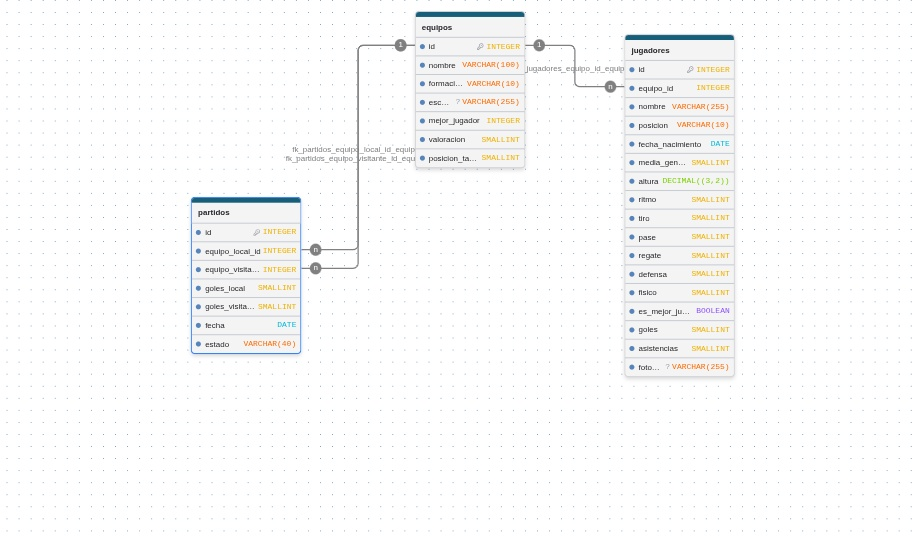

## REQUISITOS PREVIOS:
- Docker y Docker Compose instalados y en ejecución.
- Puertos `8080` (HTTP) y `5432` (PostgreSQL) libres en el equipo.

## PARA EJECUTAR EL SERVIDOR, UTILIZAR:
1. Clonar el repositorio y entrar a la carpeta:
```bash
   git clone -b tp6 https://github.com/ezequielalecci/Tp-ProgWeb
   cd Tp-ProgWeb
```

2. Levantar la aplicación con **una** de estas dos opciones:

   **Opción A: con Make (recomendada)**
```bash
   make run     # crea el .env automáticamente, genera el código, levanta la base y espera a que respondan
```

   **Opción B: con Docker Compose**
```bash
   cp .env.example .env
   sqlc generate
   templ generate
   docker compose up --build -d
```
   (el código de templ se genera dentro del build de Docker)

3. Abrir en el navegador <http://localhost:8080>. La página tiene tres pestañas, cada una con su formulario de alta y su tabla:
   - Equipos: <http://localhost:8080/>
   - Jugadores: <http://localhost:8080/?tab=jugadores>
   - Partidos: <http://localhost:8080/?tab=partidos>

4. Al terminar, borrar contenedores y volúmenes:
```bash
   make clean
   # o bien: docker compose down -v
```

> **Datos de prueba:** al iniciar se cargan equipos, jugadores y partidos de ejemplo desde `db/test-data.sql`. Si preferís arrancar con la base vacía, comentá en `docker-compose.yml` la línea:
> ```yaml
> - ./db/test-data.sql:/docker-entrypoint-initdb.d/2_test-data.sql
> ```
> Los scripts de inicialización solo se ejecutan cuando el volumen está vacío. Si cambiás algo en `db/`, ejecutá antes `make clean`.

Con `make help` se ve la lista de comandos disponibles.

## Ejecutar las pruebas

Las pruebas verifican con `curl` las páginas renderizadas y el alta por formularios. Con un solo comando se hace todo el proceso:

```bash
make test
```

Esto ejecuta, en orden:

1. **Tareas previas:** `sqlc generate` y `templ generate`, borrado de contenedores y volúmenes, compilación y arranque con Docker, y espera hasta que la base de datos y la aplicación estén listas.
2. **Pruebas:** `scripts/test-web.sh` recorre cada ruta:
   - **Páginas:** la principal y las pestañas de jugadores y partidos devuelven HTML completo con los datos de la base; las rutas inexistentes (y la vieja API) devuelven 404.
   - **Altas:** cada formulario (`POST /equipos`, `POST /jugadores`, `POST /partidos`) responde `303` con el `Location` correcto y el registro aparece en la lista siguiente.
   - **Validaciones:** datos inválidos devuelven 400 y la página vuelve a mostrarse con el mensaje de error y lo que se había escrito.
   - **Datos extra de prueba:** el equipo AC Milan, el jugador Luka Modric y el partido Barcelona vs Milan en curso.
3. **Tareas posteriores:** se borran contenedores y volúmenes, **aunque las pruebas fallen**.

Cada prueba muestra `PASS` o `FAIL` y al final un resumen (`Resultado: N correctas, M fallidas`). El comando termina con código distinto de 0 si alguna falla.

Además hay pruebas en Go (`internal/handlers/pages_test.go`) que ejercitan los mismos handlers con `httptest`. Necesitan la base levantada y el código generado:

```bash
make generate && docker compose up -d postgres
go test ./internal/handlers/
```

## DETALLES DE ESTA SEXTA PARTE (interfaces Dinámicas con HTMX):

En esta etapa del desarrollo del servidor se completó la transición de la aplicación web en Go (net/http, sqlc, templ) hacia una interacción parcial y asíncrona (SPA-like) con HTMX para todo el ciclo CRUD (crear, consultar, actualizar y eliminar) sobre las tres entidades: equipos, jugadores y partidos, manteniendo la persistencia en PostgreSQL dentro del entorno Docker.

Las principales cosas que trbajamos fueron:

- Integración de HTMX en el layout y entrega de recursos estáticos:
   Se incorporó htmx.min.js de forma local en static/ y se referenció en layout.templ (/static/htmx.min.js), evitando dependencias de CDNs externos y garantizando disponibilidad dentro     del contenedor Docker y caché del navegador.
   Se mantuvo el renderizado inicial de páginas completas y pestañas desde el servidor (PageHandler + templ), delegando a HTMX las mutaciones del DOM sin recarga completa del documento.

- Operaciones de alta (POST):
   Se configuraron los formularios de creación (hx-post, hx-target y hx-swap) para enviar datos de forma asíncrona y reemplazar únicamente el fragmento correspondiente de la                lista/sección en el DOM, en lugar de forzar una recarga completa de la vista.
   Se conservaron las validaciones de entrada y el manejo de errores de dominio/base de datos (como restricciones UNIQUE o referencias inexistentes) devolviendo respuestas HTTP             adecuadas (400 ante datos inválidos y 200 con el fragmento actualizado ante operaciones exitosas).

- Operaciones de actualización (PUT / PATCH / POST según ruta):
  Se implementaron handlers de edición en línea (como EditarEquipoForm para GET /<entidad>/{id}/edit, el handler de actualización para PUT /<entidad>/{id} y la ruta parcial de             listado/cancelación), registrados en RegisterRoutes. En las vistas .templ se crearon filas editables (*EditRow) con asociación de campos mediante el atributo form y actualización        parcial con HTMX (hx-get, hx-put, hx-target, hx-swap), manteniendo la validación y persistencia en PostgreSQL a través de la capa de service

- Operaciones de baja (DELETE):
   Se implementaron los endpoints y handlers DELETE /<entidad>/{id} en PageHandler / capa de formularios, integrados con la capa de servicio y PostgreSQL.
   En las vistas de listado (*_list.templ), se asociaron los botones de eliminación con hx-delete, hx-confirm, hx-target="closest tr" y hx-swap="outerHTML", logrando que al responder
   200 OK la fila se elimine directamente del DOM y persista el borrado en la base de datos.

- Nuevos handlers y registro de rutas en el servidor (net/http):
  
- Handlers de borrado (DELETE): se implementaron los métodos en PageHandler (por ejemplo, EliminarJugador y EliminarPartido, junto con el de equipos) encargados de extraer y validar el {id} del path, invocar a la capa de service, mapear errores de dominio/persistencia a códigos HTTP (400 por ID inválido, 404 si no existe el registro, 500 ante fallos internos) y responder 200 OK al completarse la eliminación.

- Handlers de actualización (PUT / PATCH / POST): se sumaron o adaptaron los handlers responsables de recibir los datos editados de cada entidad, validar la entrada, ejecutar la actualización en el servicio/base de datos y devolver la respuesta/fragmento actualizado correspondiente.

- Adaptación de handlers de creación (POST): se ajustaron handlers como CrearJugador (y el flujo de alta de las entidades) para que, ante un alta exitosa vía HTMX, consulten el estado actualizado y rendericen el fragmento de lista (views.*List) con 200 OK en lugar de redirigir con http.Redirect, manteniendo las respuestas de error (400) cuando fallan validaciones o restricciones de PostgreSQL.

- Registro de rutas (RegisterRoutes): se expusieron las nuevas rutas en el http.ServeMux (incluyendo los patrones DELETE /<entidad>/{id} y las rutas asociadas a actualización) conectándolas con los nuevos métodos de PageHandler.

Se validó el funcionamiento mediante inspección de red (códigos 200/304, peticiones asíncronas de HTMX), revisión de logs del servicio en Docker y comprobación de persistencia en PostgreSQL ante recargas completas (F5).

En conclusión: Durante esta etapa se consolidó una arquitectura híbrida de servidor Go con templ y HTMX para equipos, jugadores y partidos, logrando altas, actualizaciones y bajas reactivas en el DOM sin recargas completas de página, con validación en el servidor y persistencia transaccional en PostgreSQL. 

esta seria la estructura de la base de datos


DETALLES DE NUESTRA PÁGINA:
Nuestra página consta de un tablero que enseña equipos cargados por el administrador, donde los usuarios que la utilicen pueden ver información acerca de los mismos. Por ejemplo, plantel, valoración media del equipo, mejores jugadores, estadísticas individuales de cada jugador, últimos resultados de ese equipo, posición en la tabla, etc.
Para ello, cada elemento tendrá:
+ Tarjeta del equipo
    Es la información resumida que se muestra en el tablero:

    -Nombre
    -Valoración media
    -Cantidad de jugadores
    -Posición en la tabla

+ Detalle del equipo
    Se muestra al hacer clic en la tarjeta del equipo:

    -Nombre
    -Formación
    -Plantel de jugadores
    -Mejor jugador
    -Valoración media
    -Últimos resultados
    -Estadísticas generales del equipo

+ Tarjeta de jugador
    Información resumida de cada jugador dentro del plantel:

    -Nombre
    -Media del jugador
    -Posición

+ Detalle del jugador
    Informacion detallada que se muestra al hacer click sobre la carta del jugador:

    -Nombre
    -Posición
    -Edad
    -Media
    -Partidos jugados
    -Goles
    -Asistencias
    -Otras estadísticas individuales (velocidad, regate, tiro, etc)
